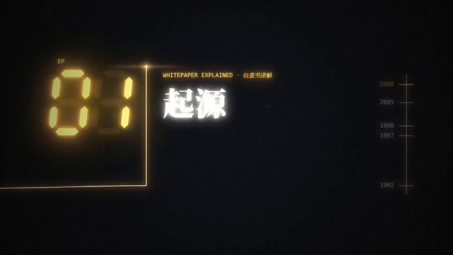

# 链上放映室 · Block Travel

**用视频的方式，重新解读区块链。**

区块链为什么会出现？没有统一的记账人，人们怎样对同一本账达成共识？智能合约又是如何运转的？

链上放映室是一个围绕区块链与 Web3 的视频解读项目。从数字现金的早期探索出发，通过一支支短片，讲述技术背后的历史、问题与机制，让抽象的概念变成可以跟随画面理解的过程。

**[进入放映室 →](https://block-travel.vercel.app/)** · [浏览全部片单](https://block-travel.vercel.app/videos)

## 每个机制，一支短片

我们希望从一个具体的问题开始，把它的来龙去脉讲清楚：为什么需要这项技术，它如何工作，又有哪些取舍。

- **从历史理解动机**：回到技术诞生时面对的问题，理解今天的设计从何而来。
- **用画面拆解机制**：把概念、角色与流程串起来，让复杂的原理更容易理解。
- **从基础走向应用**：从区块与哈希、共识与交易费用，逐步走向智能合约和链上应用。

无论你刚开始接触区块链，还是已经熟悉一些术语、想重新梳理它们之间的关系，都可以从感兴趣的一支短片开始。

## 第一站：《起源》

**白皮书讲解 · EP.01 · 03:13 · 中文字幕 · 已上线**

比特币诞生之前，数字现金走过怎样的路？

从 David Chaum 与 DigiCash 开始，经过 Hashcash、b-money 和 Bit Gold，这支短片回看比特币诞生前的关键探索，也为后续理解区块链铺下第一块基石。

[观看《起源》 →](https://block-travel.vercel.app/)

## 接下来探索什么

以下选题正在规划中，发布后会出现在片单里。

| 选题 | 想讲清楚的问题 |
| --- | --- |
| 区块与哈希 | 数据如何一块接一块，连接成一条链？ |
| 共识机制 | 没有统一的记账人，怎样对账本达成一致？ |
| Gas 费用 | 链上的一次操作，为什么需要支付费用？ |
| 智能合约 | 一段代码，如何按约定自动执行？ |
| AMM 与兑换 | 没有传统订单簿，代币之间如何完成兑换？ |

## 开始观看，也一起完善

打开[放映室](https://block-travel.vercel.app/)即可观看，无需注册。你可以在[片单](https://block-travel.vercel.app/videos)中搜索主题、按分类浏览，或选择“仅看已更新”找到已经发布的影片。

有想看的选题，或发现讲解中需要纠正的地方，欢迎[提交 Issue](https://github.com/janily/block_travel/issues)。选题建议可以附上你最想弄懂的问题；内容勘误可以注明影片、时间点和参考来源。

想参与项目开发或发布内容，请查看[开发与部署说明](docs/development.md)和[内容发布指南](docs/content-publishing.md)。
